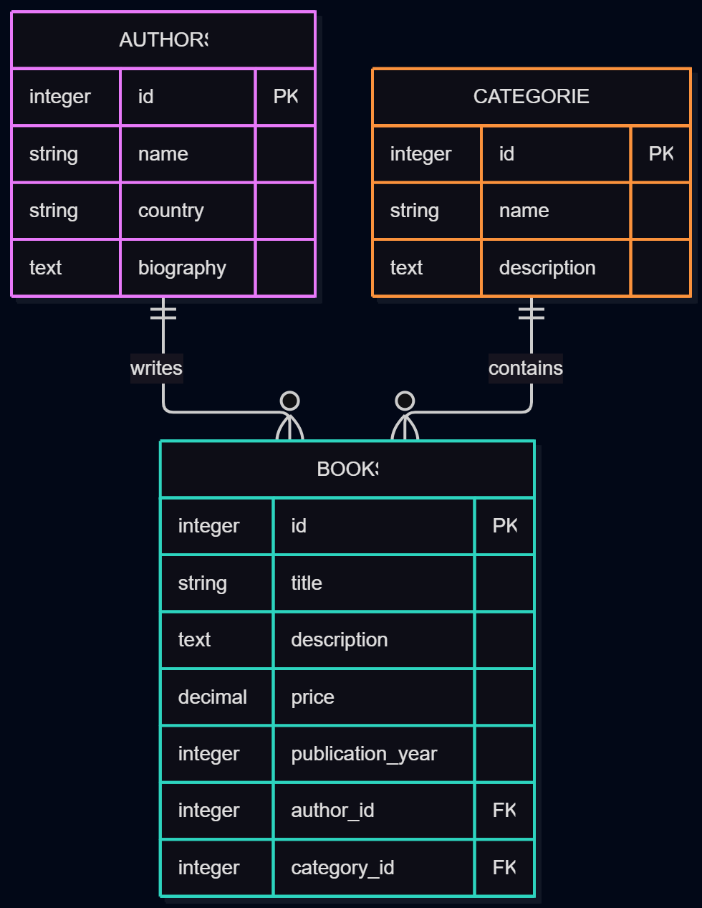

# BookNest — Online Book Catalogue

## Project Overview
BookNest is a Ruby on Rails web application that allows
users to browse, search, and explore books organized by
authors and categories.

This project was developed as part of the Rails Intro
Project assignment at RRC Polytech.

## Technologies Used
- Ruby on Rails
- Ruby
- SQLite
- ActiveRecord
- Bootstrap 5
- HTML5 and ERB
- Faker
- Kaminari (Pagination)

## Database Structure
The application uses three related tables:

1. Authors — stores author names, countries, and biographies.
2. Categories — stores book categories and descriptions.
3. Books — stores book titles, descriptions, prices,
   publication years, and references to authors and categories.

### Database Relationships
- An Author has many Books.
- A Category has many Books.
- A Book belongs to one Author.
- A Book belongs to one Category.

## Entity Relationship Diagram (ERD)

## Data Sources

BookNest uses the following sources:

### 1. Faker Gem
Faker generates sample author names, countries,
biographies, book titles, descriptions, and prices.

Source: https://github.com/faker-ruby/faker

### 2. Open Library Bibliographic Reference
Five classic books were manually added using
bibliographic information for real published works.

The records include book titles, author names,
and original publication years.

Source: https://openlibrary.org/

The book descriptions and prices are sample values.
These records are manually entered, not imported
directly from the Open Library API.

### 3. Predefined Categories
Ten book categories are defined in the seed script.

## Database Record Counts

- 255 books
- 25 authors
- 10 categories
- 290 records in total

## Application Features
- Browse the book catalogue
- View individual book details
- Search books by title
- Filter books by category
- Browse category-specific collections
- Navigate between books and categories
- Paginate book results
- View author information
- About page describing the project
- Responsive Bootstrap layout

## Running the Application

Install dependencies:

    bundle install

Prepare and seed the database:

    rails db:prepare
    rails db:seed

Start the Rails server:

    rails server

Open http://localhost:3000 in your browser.

## GitHub Repository

The complete source code for BookNest is available on GitHub:

[BookNest - GitHub Repository](https://github.com/MariamOkuniyi/booknest)

## Git codes
git add .
git commit -m "desired name"
git push origin main